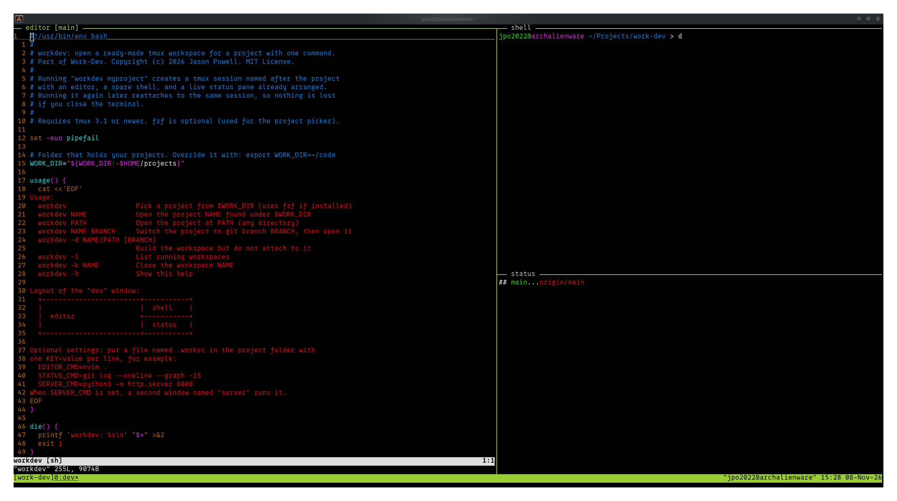

# Work-Dev: A Simple Development Environment

Work-Dev turns any project folder into a ready-made development workspace with one
command. Its main tool is `workdev`, a Bash script that opens a tmux session with an
editor, a shell, and a live git status already arranged. The repository also includes
printable cheat sheets and an accessible LaTeX style for the documentation.



## What is included

| Item | What it is |
| --- | --- |
| `bin/workdev` | Opens a tmux workspace for a project: editor, shell, and live git status |
| `docs/workdev-cheatsheet.tex` | Two-page reference for every `workdev` command, setting, and common fix |
| `docs/tmux-cheatsheet.tex` | Two-page reference for tmux sessions, windows, panes, and copy mode |
| `docs/linuxnotes.sty` | LaTeX style for Linux class handouts, built to meet WCAG 2.1 AA |
| `docs/linux-notes-template.tex` | Starter document showing every feature of the style |

## The workdev command

Running `workdev courses` builds a tmux session named after the project with three labeled
panes:

```
+--------------------------+-------------+
|                          |  shell      |
|  editor [branch]         +-------------+
|                          |  status     |
+--------------------------+-------------+
```

- **editor** opens your editor on the project. Its label shows the current git branch
  and updates when you switch branches.
- **shell** is a plain terminal in the project folder.
- **status** shows a live `git status` that refreshes every 5 seconds, or a file
  listing if the folder is not a git repository.

Running `workdev courses` again reattaches to the same workspace, so closing the terminal
loses nothing. Other features:

- `workdev courses dev` switches the project to the `dev` branch before opening it. It
  refuses to switch when there are uncommitted changes and lists existing branches when
  the name has a typo.
- A `.workrc` file in a project can change the editor or status command, or add a
  second window that starts a development server.
- Running `workdev` with no arguments shows a fuzzy project picker when `fzf` is installed.

## Requirements

| Tool | Needed for | Check with |
| --- | --- | --- |
| Bash | Running the script | `bash --version` |
| tmux 3.1 or newer | The workspace itself | `tmux -V` |
| git | Branch features and the status pane | `git --version` |
| fzf (optional) | The interactive project picker | `fzf --version` |
| watch (optional) | The live status pane | `watch --version` |
| TeX Live (optional) | Building the cheat sheet PDFs | `pdflatex --version` |

On Debian or Ubuntu, install everything at once:

```bash
sudo apt install tmux git fzf procps texlive-latex-extra texlive-fonts-recommended lmodern
```

On Fedora:

```bash
sudo dnf install tmux git fzf procps-ng texlive-scheme-medium
```

On Arch Linux:

```bash
sudo pacman -S tmux git fzf procps-ng texlive-latexextra texlive-fontsrecommended
```

## Setup guide

### 1. Clone the repository

```bash
git clone https://github.com/YOUR-USERNAME/work-dev.git
cd work-dev
```

### 2. Install the workdev command

Link the script into `~/.local/bin` instead of copying it. With a link, running
`git pull` later updates the command automatically.

```bash
mkdir -p ~/.local/bin
chmod +x bin/workdev
ln -s "$PWD/bin/workdev" ~/.local/bin/workdev
```

### 3. Set up your shell

Add these two lines to `~/.bashrc` (or `~/.zshrc` if you use zsh). Change `Projects`
to whatever folder holds your projects.

```bash
export PATH="$HOME/.local/bin:$PATH"
export WORK_DIR="$HOME/Projects"
```

Use `$HOME` rather than `~` inside the quotes. The shell does not expand `~` inside
double quotes, so `"~/Projects"` would point to a folder that does not exist.

Reload the file:

```bash
source ~/.bashrc
```

### 4. Organize your projects

Keep each project as its own folder directly inside `WORK_DIR`. Each one is usually a
git repository, but plain folders work too.

```
~/Projects/
├── courses/
├── website/
└── grading-scripts/
```

The picker only looks one level deep. A project nested further down still opens by
path, for example `workdev ~/Projects/school/cs101`.

### 5. Check that it works

```bash
which workdev       # should print /home/YOUR-NAME/.local/bin/workdev
workdev -h          # shows the built-in help
workdev courses     # opens the workspace
```

Inside tmux, press `Ctrl+b` then `d` to detach and leave the workspace running.

## Everyday use

| Command | What it does |
| --- | --- |
| `workdev` | Pick a project from `WORK_DIR` |
| `workdev NAME` | Open a project, or reattach if it is already running |
| `workdev PATH` | Open any folder by path, such as `workdev .` |
| `workdev NAME BRANCH` | Switch to a git branch, then open the project |
| `workdev -d NAME` | Build the workspace without attaching |
| `workdev -l` | List running workspaces |
| `workdev -k NAME` | Close a workspace completely |

### Per-project settings

Create a file named `.workrc` in a project folder with one `KEY=value` per line. The
script reads these values but never executes the file, so opening a cloned project
cannot run unexpected code.

```
EDITOR_CMD=nvim .
STATUS_CMD=git log --oneline --graph -15
SERVER_CMD=python3 -m http.server 8000
```

`SERVER_CMD` adds a second window named `server` that runs the command. To keep
`.workrc` out of a project's git history, add it to that project's
`.git/info/exclude` file.

## Building the cheat sheets

The cheat sheets use `docs/linuxnotes.sty`, which must sit in the same folder as the
`.tex` files. Compile each file twice so the "Page X of Y" footers resolve:

```bash
cd docs
for f in workdev-cheatsheet tmux-cheatsheet; do
  pdflatex "$f.tex" && pdflatex "$f.tex"
done
```

The style sets the PDF title and language, gives every table a caption and header row,
and uses color shades that meet WCAG 2.1 AA contrast. After building, run Adobe
Acrobat's automatic tagging and mark each table's shaded first row as header cells.

To start a new handout, copy `docs/linux-notes-template.tex` and follow the comments
inside it.

## Troubleshooting

| Problem | Fix |
| --- | --- |
| `workdev: command not found` | Check that `~/.local/bin` is on your PATH with `echo $PATH`, then open a new terminal |
| "cannot find a project" | Run `echo $WORK_DIR` and confirm it shows a full path, not one starting with `~` |
| Only some panes appear | Panes were closed with `exit`. Run `workdev -k NAME`, then `workdev NAME` |
| Branch switch refused | Commit your changes or run `git stash`, then try again |

The workdev cheat sheet covers these and other fixes in more detail.

## Repository layout

```
work-dev/
├── README.md
├── LICENSE
├── LICENSE-DOCS
├── .gitignore
├── bin/
│   └── workdev
└── docs/
    ├── linuxnotes.sty
    ├── linux-notes-template.tex
    ├── workdev-cheatsheet.tex
    └── tmux-cheatsheet.tex
```

## License

Work-Dev uses two licenses, one for code and one for written materials.

| Content | License | File |
| --- | --- | --- |
| Code: `bin/workdev` and `docs/linuxnotes.sty` | MIT License | `LICENSE` |
| Written materials: the cheat sheets, the template, and this README | Creative Commons Attribution 4.0 (CC BY 4.0) | `LICENSE-DOCS` |

You are welcome to use and adapt the cheat sheets in your own courses. Please credit
the original, for example: "Based on Work-Dev by Jason Powell, licensed under CC BY 4.0."
